<div align="center">


# Viku

**Native iOS client for Vikunja with beautiful design and great user experience.**

</div>

> ⚠️ Beta. Bugs are expected. Don't point it at a production Vikunja instance without a tested backup.

This is an opinionated mobile client for Vikunja, not a full port of the web app. 
Vikunja already has an official PWA and a [capable third-party one](https://github.com/Bassey240/vikunja-pwa), 
and both aim to mirror the web experience feature for feature. This app takes a different position.

It is built to be what you reach for when you are away from your computer: a
fast, native view of what matters today, and a frictionless way to capture a
task before you forget it. Planning, reorganizing, and deep project work stay on
the web, where they belong.

## Screenshots

| Home | Projects | Task |
|---|---|---|
| 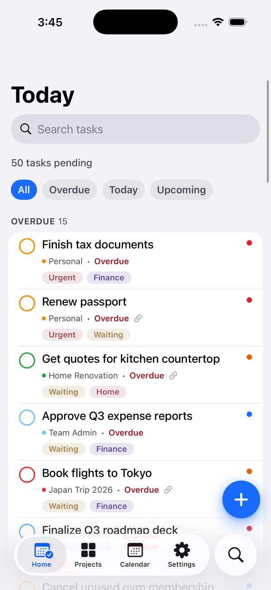 | 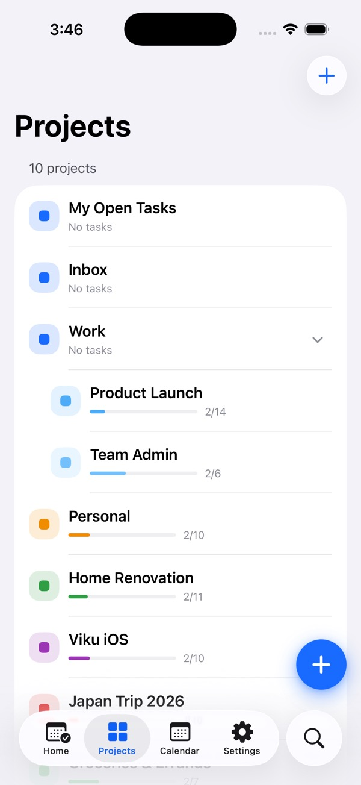 | 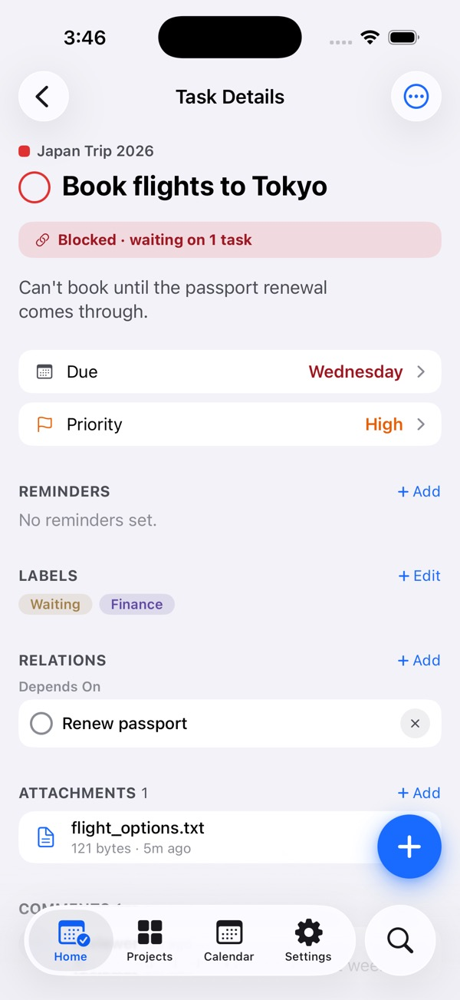 |

| Quick add | Calendar | Kanban |
|---|---|---|
| 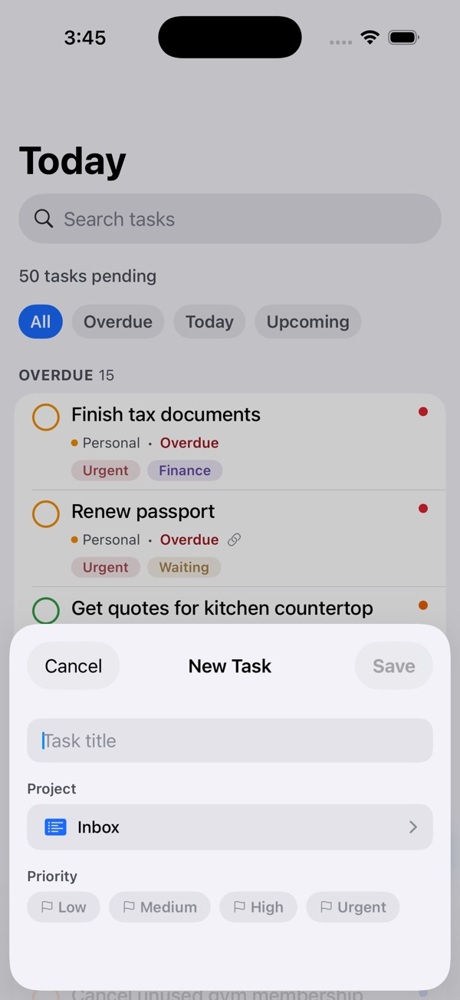 | 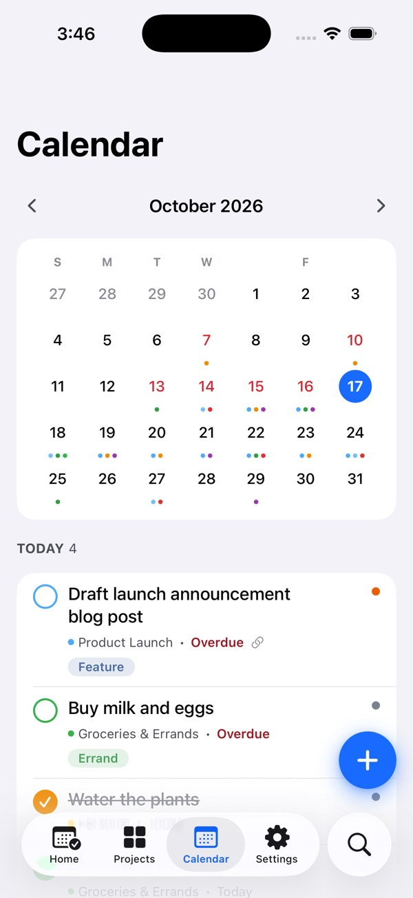 | 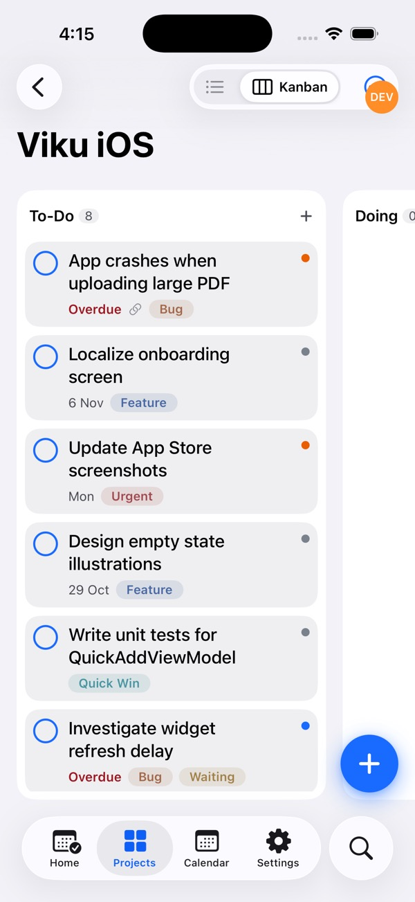 |

| Home widgets | Calendar widget |
|---|---|
| 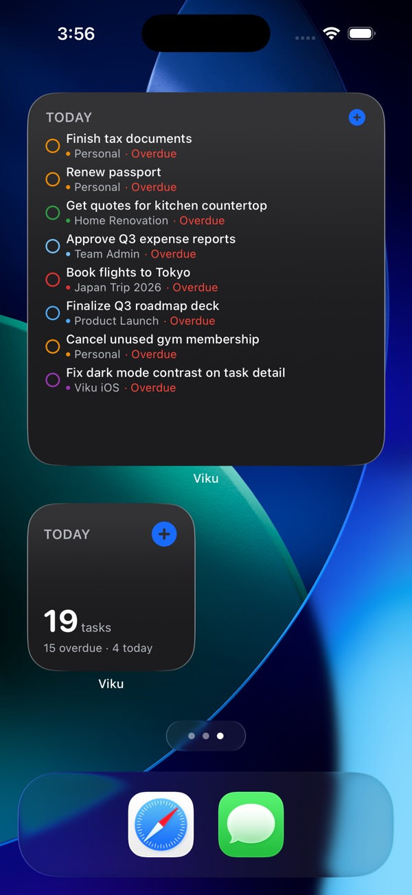 | 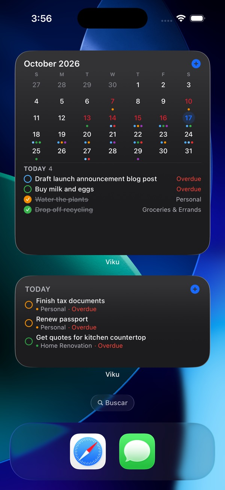 |

## Themes

| Light | Dark | Warm |
|---|---|---|
|  | 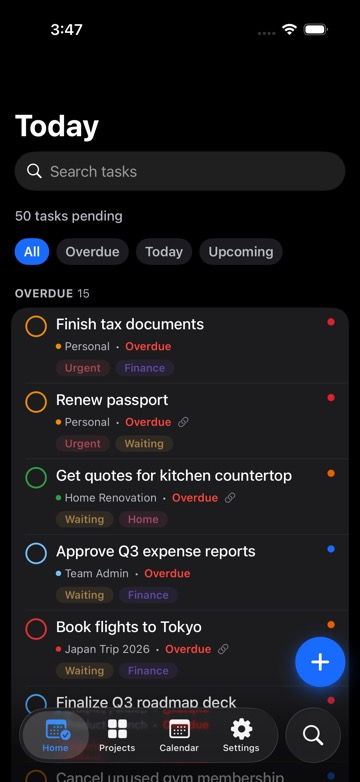 | 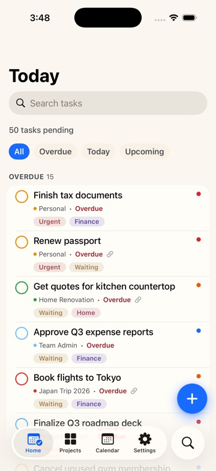 |

| Forest | Nord | Solarized |
|---|---|---|
| 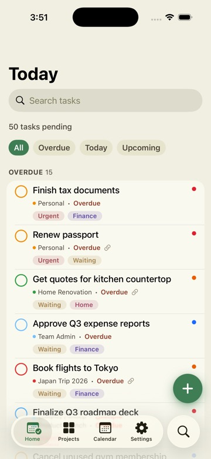 | 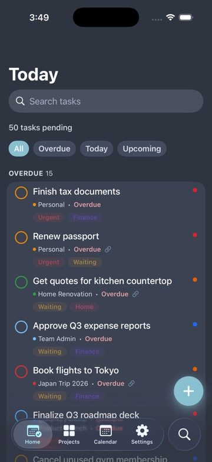 | 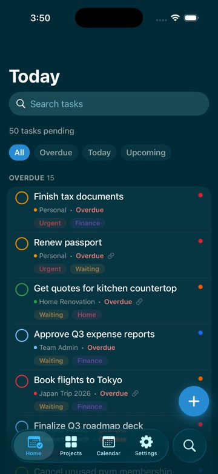 |

| Terminal | Cyberpunk | Vaporwave |
|---|---|---|
| 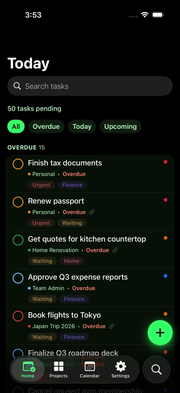 | 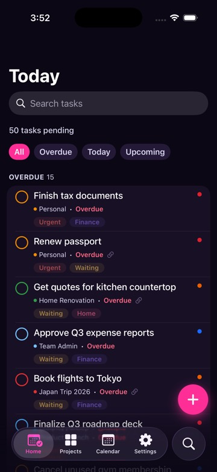 | 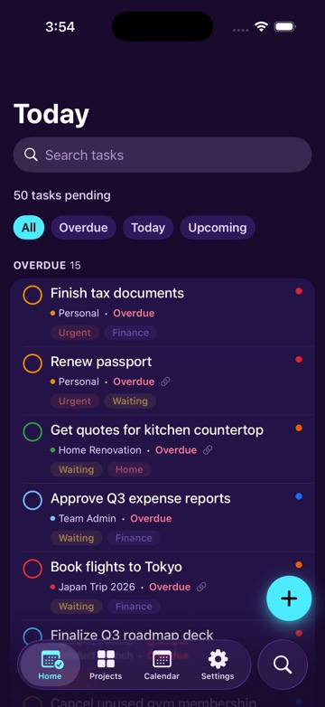 |

## How to Use

### Installation

The app is currently in Beta and can be installed via Testflight:

[Join the beta →](https://testflight.apple.com/join/aby3Bh4d)

**Requires iOS 26.2+** (the app relies on the native Liquid Glass UI introduced in iOS 26).

### Setup

Connect to your Vikunja instance using whichever method it supports:

- **API Token** — create one in Vikunja. See the [required scopes](#required-permissions).
- **Username & Password** — available when your instance has local auth enabled.
- **Single Sign-On (OIDC)** — available when your instance has an OpenID Connect
  provider configured. See [OIDC Setup](#oidc-setup) below before your first sign-in.

The app detects which of these your instance supports as you type its address,
and only shows the ones that are actually available.

## Features

### The app

- **Multiple Instances:** Connect several Vikunja accounts and switch between them.
- **Home:** An account-wide list of what is overdue, due today, and coming up across every project, behind quick filters. Pin a project or a saved filter in Settings to show that instead.
- **Quick Capture:** Add a task in one tap from the tab bar, the Today home-screen widget, or the `viku://quick-add` deep link
- **Quick-add shortcuts (experimental):** Set the project, priority and labels by typing them into the title. See [Quick-Add Shortcuts](docs/quick-add-shortcuts.md).
- **Widgets:** Quickly see your daily tasks and a calendar view from your Home screen.
- **Kanban board:** Switch a project between List and Kanban view, drag tasks between buckets, and add tasks directly into a bucket. Requires a Vikunja instance on 2.4.0+.
- **Themes:** Multiple color palettes, including light, dark and Warm, with live previews in Settings > Appearance.

### Planned

- Offline Support
- Native Push Notifications


### Vikunja API Coverage

The app is a focused client, not a full port of the web UI, 
so it covers the parts of the API that matter for day-to-day mobile use

**Tasks**

- Create, update, delete
- Move a task to another project
- Account-wide search
- Duplicate (client-side copy)
- Editable fields: title, description, completion, due date, priority, labels, reminders


**Projects**

- Create, update, delete
- Nest a project under a parent

**Saved Filters**

- View tasks, rename, view the query, delete, pin to Home
- No creating or editing the query itself

**Labels**

- Create, rename, recolor, delete
- Assign and unassign on a task

**Comments**

- Add, edit, delete

**Task relations**

- Add and remove relations between tasks

**Attachments**

- List, upload, download and preview, delete

**Kanban**

- View a project's buckets with their tasks
- Drag a task between buckets, including the done bucket (syncs the task's completion state)
- Add a task directly into a bucket
- Requires Vikunja 2.4.0+; the List/Kanban toggle is hidden on older servers

**Not yet supported**

- Start dates, assignees, percent done, repeating tasks, task colors
- Custom project views
- Kanban bucket management (create/rename/delete/reorder buckets, WIP limits), intra-column reordering, filter-populated buckets
- Gantt, table views
- Team and permission management, instance settings
- Bulk editing

### Server Version Support

Viku works with any Vikunja instance, detecting what your server supports
at runtime and using the newer v2 API when available (2.4.0+), falling back
to v1 otherwise. No action needed on your end. See
[Server Version Support](docs/server-version-support.md) for the full
compatibility plan and Vikunja's v1 retirement timeline.

## OIDC Setup

If your Vikunja instance has an OpenID Connect provider configured (Authentik,
Keycloak, Authelia, Google, ...), you can sign in with it directly instead of
using an API token or a username and password.

Before your first sign-in, ask your instance admin to add this app's redirect
URI as an **additional** allowed redirect URI on the provider's client
configuration, alongside the one already used by Vikunja's own web frontend:

```
viku://oidc-callback
```

This is a one-time change on the identity provider's side, not something each
user has to do — most providers (Authentik, Keycloak, Authelia, Google, ...)
let a single client have more than one allowed redirect URI. Without it, the
provider will refuse the app's sign-in request even though the same login
works fine from a browser.

## Required Permissions

If you connect using an API Token instead of username/password or OIDC, make
sure it has at least the following permissions:

| Group | Permissions |
|---|---|
| `projects` | create, read all, read one, update, delete, tasks by index |
| `tasks` | create, read one, read all, update, delete |
| `tasks comments` | create, read all, update, delete |
| `tasks attachments` | create, read all, read one, delete |
| `tasks labels` | create, delete |
| `tasks relations` | create, delete |
| `labels` | create, read all, update, delete |
| `other` | user |

## Philosophy & Scope

### What it is for

- **Today at a glance.** An account-wide view of what is overdue, due today, and coming up, across every project.
- **Capturing tasks fast.** From the home-screen widget, a deep link, Siri, or a one-tap sheet, with the minimum fields needed and nothing else.
- **Checking in on projects.** A simple browsable tree with completion progress, plus enough task detail (due date, priority, labels, comments, attachments, relations) 
    to act on something without switching devices.
- **Staying out of the way.** Native, lightweight, quick to open and quick to close.

### What it is not

- Not a reimplementation of the full Vikunja web UI.
- No creating or editing saved filter queries, no Gantt, no bulk editing.
- No team or permission administration, no instance configuration.
- Not a place for long planning sessions. It is tuned for glances and quick capture, not for restructuring your workload.

---

**This project is not affiliated with the official Vikunja project.**
