<div align="center">


# Viku

**A native iOS client for Vikunja, built for everyday task management.**

</div>

> ⚠️ Beta. Bugs are expected. Don't point it at a production Vikunja instance without a tested backup.

Check what matters today, capture tasks quickly, and manage projects on the go.
Viku focuses on quick interactions rather than the full Vikunja web experience.

## Screenshots

| Home | Projects | Task |
|---|---|---|
| 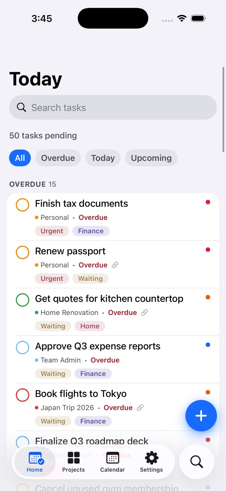 |  | 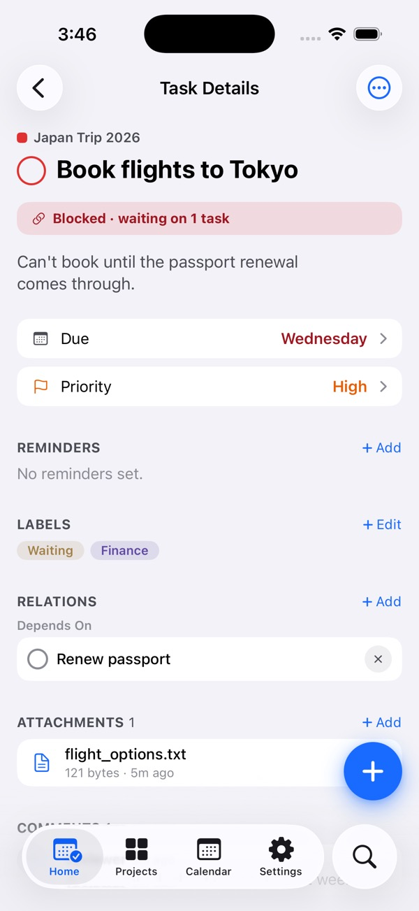 |

| Quick add | Calendar | Kanban |
|---|---|---|
| 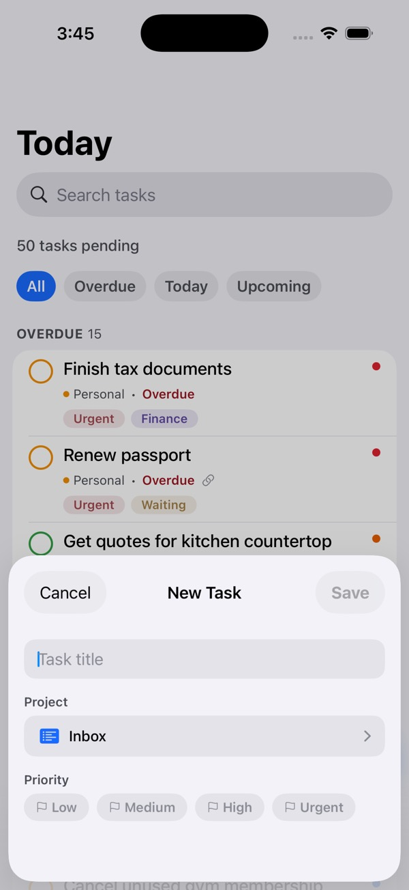 | 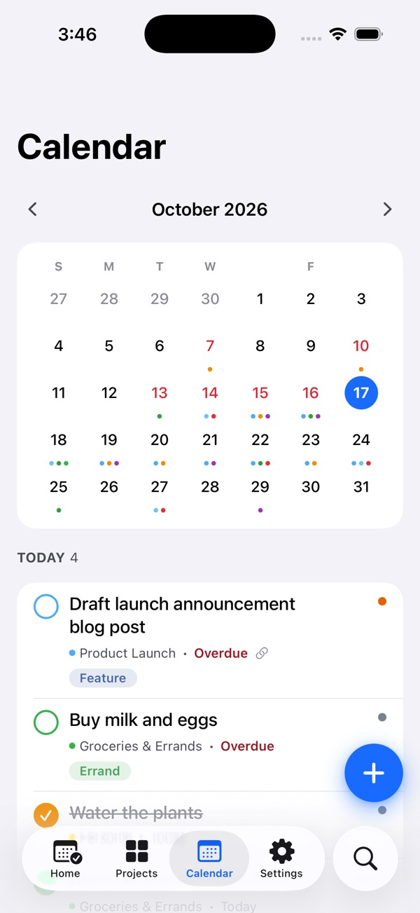 | 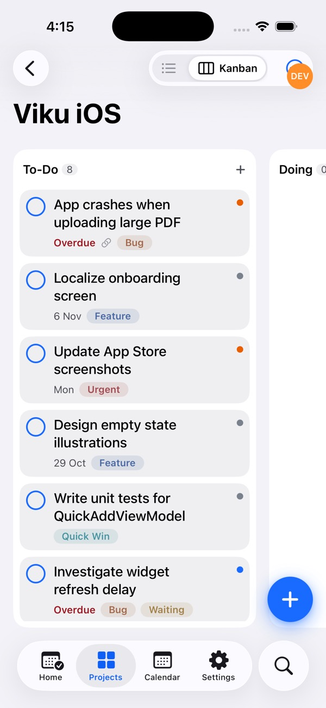 |

| Home widgets | Calendar widget |
|---|---|
| 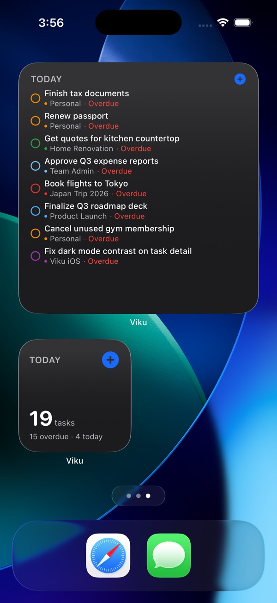 | 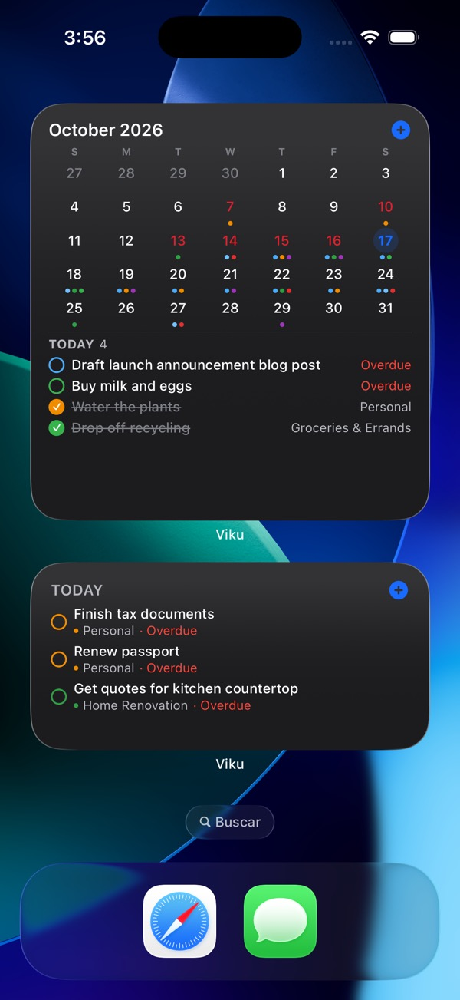 |

## Themes

| Light | Dark | Warm |
|---|---|---|
|  | 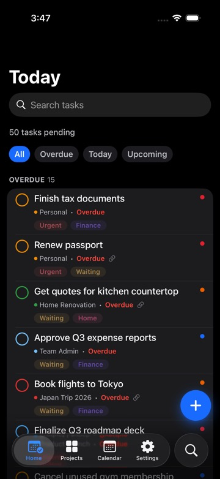 | 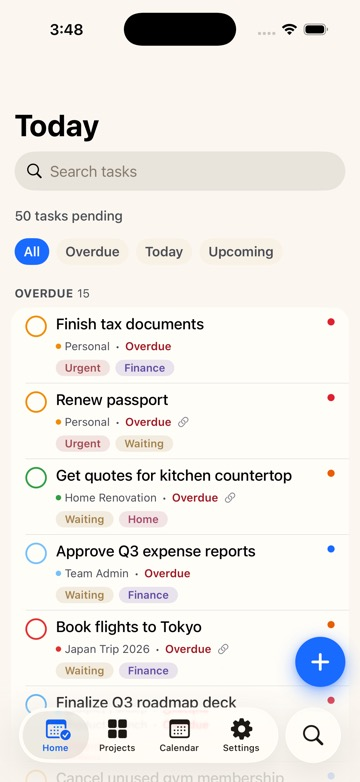 |

| Forest | Nord | Solarized |
|---|---|---|
| 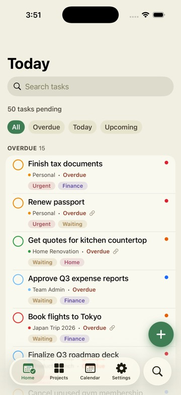 | 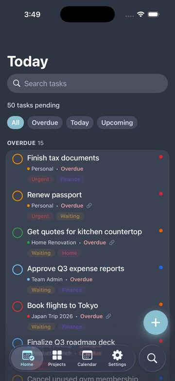 | 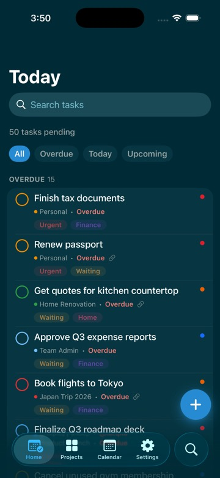 |

| Terminal | Cyberpunk | Vaporwave |
|---|---|---|
| 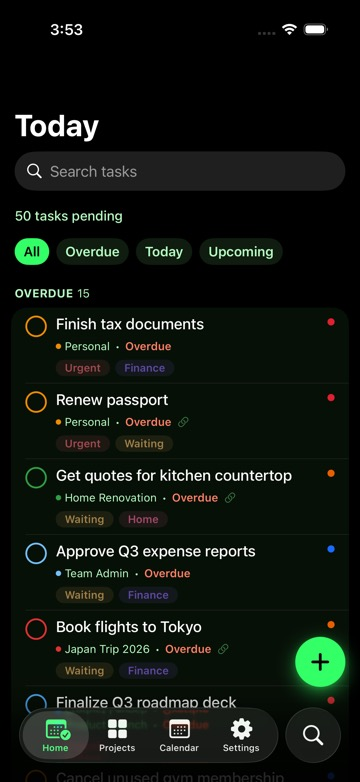 | 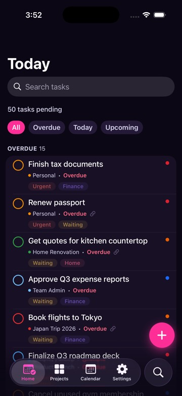 | 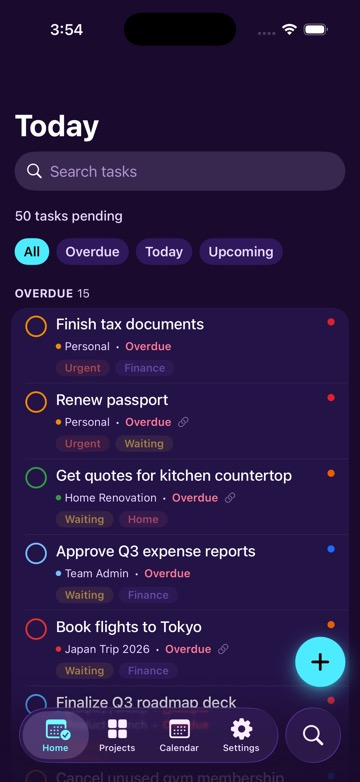 |

## Getting Started

### Installation

[Join the TestFlight beta →](https://testflight.apple.com/join/aby3Bh4d)

**Requires iOS 26.2+.**

### Setup

Enter your Vikunja instance URL and sign in using:

- **API Token** ([required permissions](#required-permissions))
- **Username & Password**
- **Single Sign-On (OIDC)** ([setup](#oidc-setup))

Viku automatically detects which sign-in methods your instance supports.

## Features

- **Multiple accounts:** Switch between accounts and Vikunja instances.
- **Home:** See overdue, today’s, and upcoming tasks, or pin a project or saved filter.
- **Quick capture:** Add tasks from the tab bar, Today widget, Siri, or `viku://quick-add`.
- **Quick Add Magic:** Set project, priority, labels, and date in the task title. [Guide →](docs/guides/en/quick-add-shortcuts.md)
- **Widgets:** Daily tasks and calendar views on your Home screen.
- **Kanban:** Move tasks between buckets and create tasks in a bucket. Requires Vikunja 2.4.0+.
- **Themes:** Multiple color palettes to choose from.
- **Offline support (early stage):** Browse cached data and make changes that sync when you reconnect. Bugs are still expected.

**Planned:** Native push notifications.

### Supported Operations

| Area | Supported operations |
|---|---|
| Tasks | Create, edit, delete, move between projects, search, duplicate (client-side copy) |
| Task fields | Title, description, completion, due date, priority, labels, reminders |
| Projects | Create, edit, delete, nest under a parent |
| Saved filters | View tasks and query, rename, delete, pin to Home |
| Labels | Create, rename, recolor, delete, assign to or remove from tasks |
| Comments | Add, edit, delete |
| Task relations | Add, remove |
| Attachments | List, upload, download, preview, delete |

### Not Yet Supported

- Start dates, assignees, percent done, repeating tasks, task colors
- Creating or editing saved filter queries
- Custom project views, Gantt, table views
- Kanban bucket management, WIP limits, intra-column reordering, filter-populated buckets
- Team and permission management, instance settings
- Bulk editing

### Server Compatibility

Viku detects server capabilities automatically, using API v2 on Vikunja 2.4.0+
with a v1 fallback for older servers.
[Compatibility details and v1 retirement timeline →](docs/guides/en/server-version-support.md)

## OIDC Setup

Before your first OIDC sign-in, ask your instance administrator to **add** this
redirect URI to the identity provider’s client configuration, keeping Vikunja’s
existing web redirect URI:

```text
viku://oidc-callback
```

This is a one-time setup per provider client. Without it, the provider will
reject the app’s sign-in request even if browser sign-in works.

## Required Permissions

For API token sign-in, grant at least these permissions:

| Group | Permissions |
|---|---|
| `projects` | create, read all, read one, update, delete, tasks by index |
| `tasks` | create, read one, read all, update, delete |
| `tasks comments` | create, read all, update, delete |
| `tasks attachments` | create, read all, read one, delete |
| `tasks labels` | create, delete |
| `tasks relations` | create, delete |
| `labels` | create, read all, update, delete |
| `other` | user |

---

**This project is not affiliated with the official Vikunja project.**
